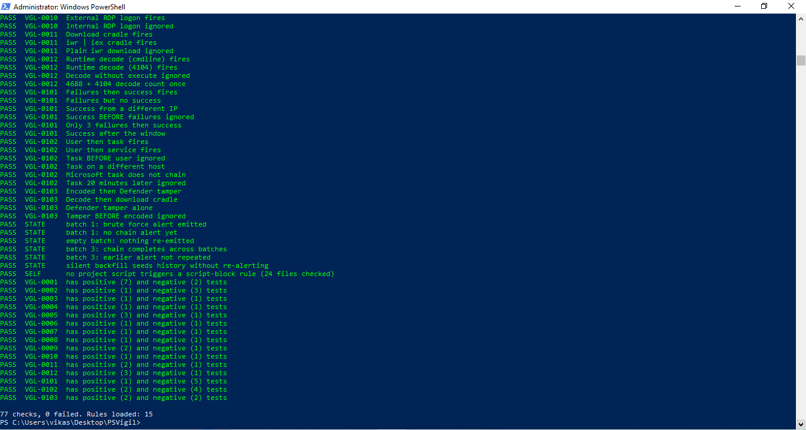
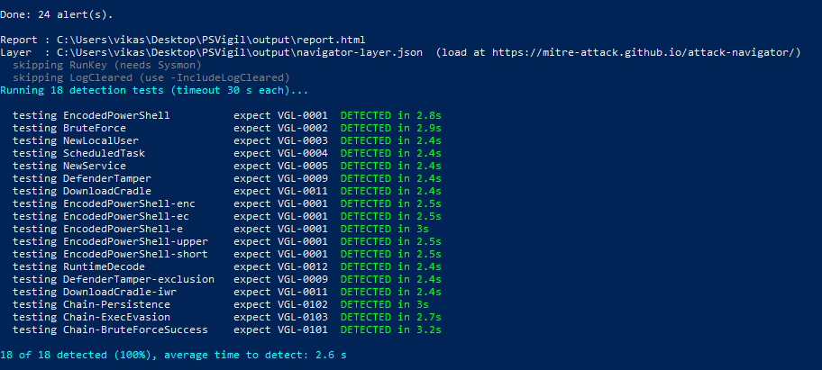
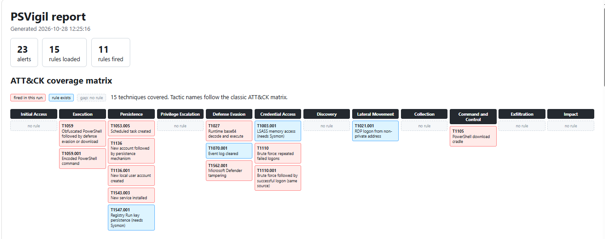
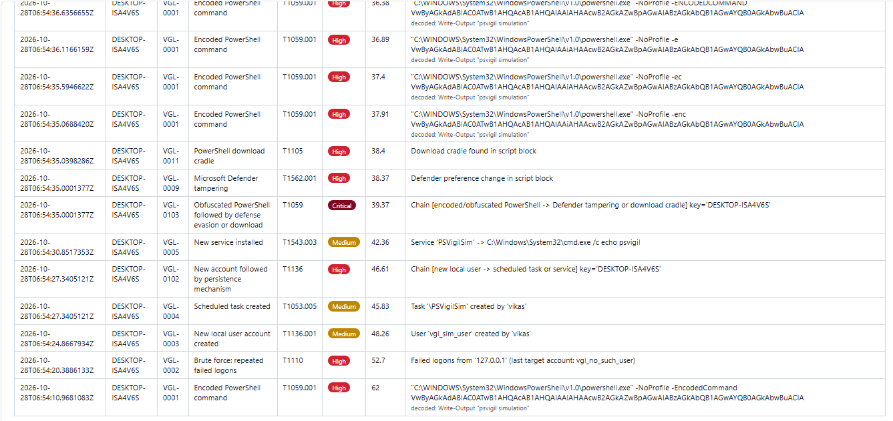
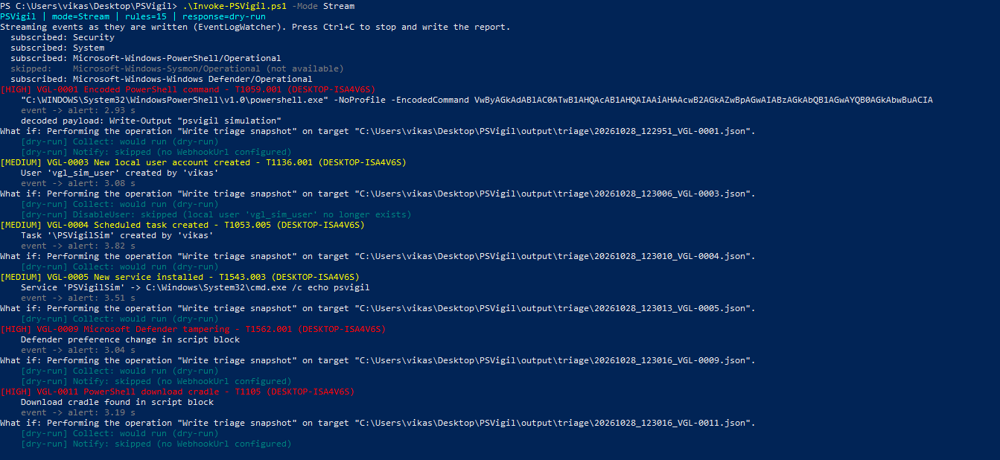

# PSVigil

A **PowerShell-only mini SIEM** for Windows: it collects event logs, normalizes them, runs 15 ATT&CK-mapped detection rules
(including multi-step correlation rules), runs dry-run-by-default response actions, produces an HTML report with an
ATT&CK coverage matrix, and **measures its own detection rate** against safe attack simulations.

No third-party modules are required (Sysmon is optional). Everything is Windows PowerShell 5.1 compatible.

> Lab project. Run it in a VM you can snapshot, not on a machine you care about.

## Results

Measured on one Windows machine (Windows 10 Home, version 22H2, OS build 19045.6466) with Windows PowerShell 5.1.

| What | Result |
|---|---|
| Offline fixture tests | 77 checks, 0 failed (positive and negative case for every rule, plus ordering, de-duplication and streaming-state tests) |
| Detection harness, live logs | **18 of 18 detected in two consecutive runs**, average time to detect 2.2 s and 2.3 s |
| Stream mode (event-driven) | 2.34 s, 6.97 s and 2.5 s from event creation to alert on the three alerts I measured |
| Sample scan (3 min after running the simulations) | 16 alerts, 10 of 15 rules fired |

How the harness works: each simulation runs, then the harness polls the real Windows logs every second until the
expected rule fires. "Time to detect" is measured from the end of the simulation, so it includes the time Windows
takes to write the event and the 1 s polling interval. RunKey (needs Sysmon) and LogCleared (destructive, opt-in) are
not in the 18.

<details>
<summary>Full per-test table (second 18/18 run)</summary>

| Test | Group | ATT&CK | Expected rule | Result | Time to detect (s) |
|---|---|---|---|---|---|
| EncodedPowerShell | basic | T1059.001 | VGL-0001 | Detected | 2.6 |
| BruteForce | basic | T1110 | VGL-0002 | Detected | 2.6 |
| NewLocalUser | basic | T1136.001 | VGL-0003 | Detected | 2.1 |
| ScheduledTask | basic | T1053.005 | VGL-0004 | Detected | 2.0 |
| NewService | basic | T1543.003 | VGL-0005 | Detected | 2.1 |
| DefenderTamper | basic | T1562.001 | VGL-0009 | Detected | 2.0 |
| DownloadCradle | basic | T1105 | VGL-0011 | Detected | 2.0 |
| EncodedPowerShell-enc | variants | T1059.001 | VGL-0001 | Detected | 2.2 |
| EncodedPowerShell-ec | variants | T1059.001 | VGL-0001 | Detected | 2.1 |
| EncodedPowerShell-e | variants | T1059.001 | VGL-0001 | Detected | 2.1 |
| EncodedPowerShell-upper | variants | T1059.001 | VGL-0001 | Detected | 2.1 |
| EncodedPowerShell-short | variants | T1059.001 | VGL-0001 | Detected | 2.1 |
| RuntimeDecode | variants | T1027 | VGL-0012 | Detected | 2.1 |
| DefenderTamper-exclusion | variants | T1562.001 | VGL-0009 | Detected | 2.1 |
| DownloadCradle-iwr | variants | T1105 | VGL-0011 | Detected | 2.1 |
| Chain-Persistence | chains | T1136 | VGL-0102 | Detected | 2.5 |
| Chain-ExecEvasion | chains | T1059 | VGL-0103 | Detected | 2.8 |
| Chain-BruteForceSuccess | chains | T1110.001 | VGL-0101 | Detected | 3.5 |

The full output of every run is in [`docs/detection-results.md`](docs/detection-results.md).
</details>

## Screenshots

**Offline tests**



**Detection harness against the live logs**



**Report: ATT&CK coverage matrix** (red = fired in this run, blue = rule exists, dashed = gap)



**Report: alerts, including correlation chains and a decoded payload**



**Stream mode: events become alerts as they are written**



## How it works

```
Windows logs --> Collector --> Normalizer --> Detection engine --> Response --> Report
(Security, System,  (Get-WinEvent    (common event    (single rules, thresholds,   (dry-run by    (HTML + ATT&CK
 PowerShell, Sysmon,  or EventLogWatcher) schema)        de-duplication,              default)       matrix + Navigator
 Defender)                                                correlation chains)                         layer)
```

Three ways to collect:

| Mode | Command | Notes |
|---|---|---|
| Scan | `.\Invoke-PSVigil.ps1 -Mode Scan -Minutes 30` | One-shot read of recent events; supports `-ComputerName` |
| Watch | `.\Invoke-PSVigil.ps1 -Mode Watch` | Polls every few seconds; supports `-ComputerName` |
| Stream | `.\Invoke-PSVigil.ps1 -Mode Stream` | Event-driven via the .NET `EventLogWatcher`; local machine only |

## Detection rules (15)

| Rule | Technique | Type | Source |
|---|---|---|---|
| VGL-0001 Encoded PowerShell (-e / -ec / -enc* / -EncodedCommand) | T1059.001 | Single + dedupe | 4688 / Sysmon 1 |
| VGL-0002 Brute force (5 failures / 5 min / source) | T1110 | Threshold | 4625 |
| VGL-0003 New local user | T1136.001 | Single | 4720 |
| VGL-0004 Scheduled task created (Microsoft tasks excluded) | T1053.005 | Single | 4698 |
| VGL-0005 New service (7045 + 4697 collapsed to one alert) | T1543.003 | Single + dedupe | 7045 / 4697 |
| VGL-0006 Run key persistence | T1547.001 | Single | Sysmon 13 |
| VGL-0007 LSASS access | T1003.001 | Single | Sysmon 10 |
| VGL-0008 Event log cleared | T1070.001 | Single | 1102 / 104 |
| VGL-0009 Defender tampering | T1562.001 | Single | 4104 / Defender 5001 |
| VGL-0010 RDP logon from non-private IP | T1021.001 | Single | 4624 |
| VGL-0011 Download cradle (DownloadString/File, iwr piped to iex) | T1105 | Single | 4104 |
| VGL-0012 Runtime base64 decode and execute | T1027 | Single + dedupe | 4688 / 4104 |
| VGL-0101 Brute force then successful logon, same source IP | T1110.001 | Correlation | 4625 + 4624 |
| VGL-0102 New account then scheduled task or service, same host | T1136 | Correlation | 4720 + 4698 / 7045 |
| VGL-0103 Obfuscated PowerShell then Defender tamper or download, same host | T1059 | Correlation | 4688 + 4104 |

A **correlation rule** is an ordered chain of steps that must occur for the same key (host, source IP) inside a time
window. Order matters: a scheduled task created *before* the account does not chain. Steps can reference other rules
(`Rules = @('VGL-0004','VGL-0005')`) or use their own `Match` block with `MinCount`.

## Quick start

Open **PowerShell as Administrator** in the project folder:

```powershell
Set-ExecutionPolicy -Scope Process -ExecutionPolicy Bypass
Get-ChildItem -Recurse | Unblock-File

.\Invoke-Tests.ps1                                         # offline tests, no admin logs needed
.\Setup-Telemetry.ps1                                      # enable auditing + script block logging (once)
.\Invoke-Simulations.ps1 -Run All                          # safe attack simulations (also: -Run Variants, -Run Chains)
Start-Sleep 10
.\Invoke-PSVigil.ps1 -Mode Scan -Minutes 5 -OpenReport     # detect and report
.\Invoke-DetectionTest.ps1                                 # measure detection rate and time to detect
```

Optional: `.\Setup-Telemetry.ps1 -InstallSysmon` downloads Sysmon from Microsoft so rules VGL-0006 and VGL-0007 can fire.

Response actions (`BlockIp`, `DisableUser`, `Collect`, `Notify`) are **dry runs by default**. `-EnableResponse` executes
them. Loopback and `ProtectedIps` are never blocked; `Administrator`, your own account and machine accounts are never disabled.

## Findings from building and testing

These are the things I would want a reviewer to see, including the failures.

1. **Evasion gaps in my own first rules.** Testing the first version of VGL-0001 against variants showed it missed short
   payloads and `-en*` abbreviations, and that a payload decoded in-line (no encoded-command switch) and `iwr | iex`
   cradles were invisible. Fixes: wider VGL-0001 (now also requires `powershell`/`pwsh` in the command line to avoid
   flagging unrelated `-e` switches), new rule VGL-0012, extended VGL-0011. The 8 evasion variants in the harness now
   all detect on live logs.
2. **The tool alerted on itself.** PowerShell script block logging records the text of every script that runs,
   including this project's own simulations and test fixtures, so they triggered the script-block rules. Fix: trigger
   strings are assembled at runtime from fragments, rule regexes use character classes, and `Invoke-Tests.ps1` has a
   guard check that no project script matches a script-block rule.
3. **Bugs that only showed up on real Windows.** The collector looped zero times for local scans (0 events collected);
   `net.exe` errors aborted a simulation under `-ErrorAction Stop`; an interrupted run left a test user behind. The
   offline tests could not have caught these, which is why the live harness exists.
4. **Intermittent detections.** Early live harness runs scored 13/18 and 16/18; every miss was a simulation that runs
   inside the PowerShell host process I was reusing. In a control test, a harmless marker string was logged once and
   not on the next two identical runs, while Defender reported no detections and the log was enabled and not full.
   After making each in-process script text unique, the harness scored 18/18 twice. My working explanation is that
   Windows PowerShell does not log a repeated identical script block in the same process; I did **not** isolate that
   with a clean same-text versus unique-text comparison, so treat it as an observation, not a proven cause.
5. **A false positive on a real machine.** VGL-0004 alerted on the scheduled task
   `\PlatformExperiencesHelper_OnUnlock`, which was not one of my simulations. Checking it with
   `Get-ScheduledTask` showed that its action runs `platform_experiences_helper.exe` from the Microsoft Edge
   install folder, and the binary's Authenticode signature is valid and issued to Microsoft Corporation, so it
   is an Edge component. My rule only excludes tasks under `\Microsoft\`, and this task is registered in the root
   task folder, so it slipped through. Excluding by task name or folder alone is fragile; a better rule would judge
   the task's action (a signed binary in a known vendor path). I have not implemented that yet.

## Limitations

* Lab project on a single machine. Simulations are benign approximations of techniques, not real malware, so the
  detection rate describes these simulations only.
* Most rules are pattern or event-ID matches and can be evaded (string splitting, renamed binaries, techniques that
  do not log what the rule expects). The correlation rules are simple ordered chains.
* Detection depends on Windows logging being enabled and not tampered with. Script block logging is only as reliable as
  Windows makes it (see finding 4).
* Response actions were only exercised in dry-run mode. I did not run them with `-EnableResponse`.
* VGL-0007 (LSASS) and VGL-0010 (RDP) are covered by fixture tests only; VGL-0006 and VGL-0007 need Sysmon.
* Stream mode reads the local machine only.

## Roadmap

Allowlist configuration, baselining of normal process and task behavior, WMI persistence and `certutil`/`bitsadmin`
detections, alert scoring, remote streaming over WinRM, and a repeat-runs option that reports a detection rate per rule.

## Repository layout

```
Invoke-PSVigil.ps1        main runner (Scan / Watch / Stream)
Invoke-Simulations.ps1    safe, self-cleaning attack simulations
Invoke-DetectionTest.ps1  validation harness (detected / missed / time to detect)
Invoke-Tests.ps1          offline fixture tests (CI-friendly exit code)
Setup-Telemetry.ps1       turns on the Windows logging the rules need
src/PSVigil.psm1          collector, normalizer, engine, correlation, response, reporting
rules/                    one file per rule
simulations/Catalog.ps1   simulation catalog
tests/                    fixtures (+ Pester wrapper)
config/                   settings and a minimal Sysmon config
docs/                     screenshots and detection results
```

To add a rule, drop a file in `rules\` that returns a hashtable (copy any `VGL-*.ps1`): `Id, Title, Technique, Severity`
plus either `Match` (a scriptblock taking `$e`) or `Correlation`. Add one scenario that must fire and one that must not
to `tests\Scenarios.ps1`, then run `.\Invoke-Tests.ps1`.


